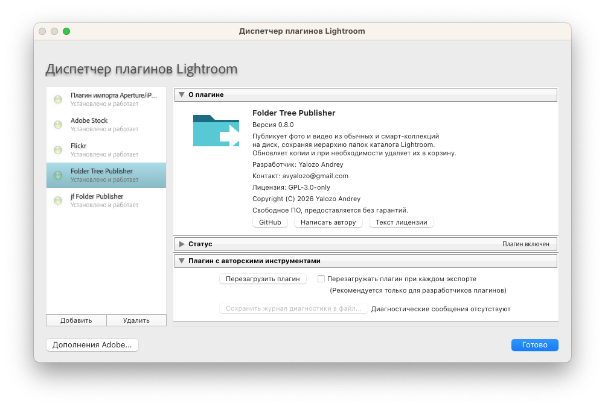
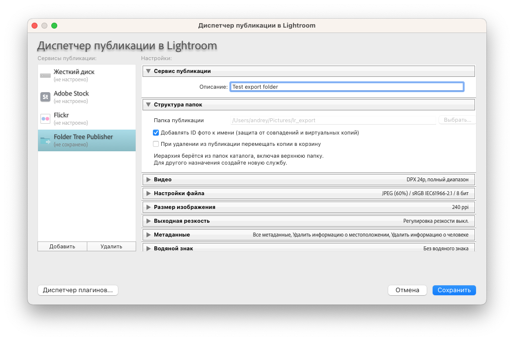
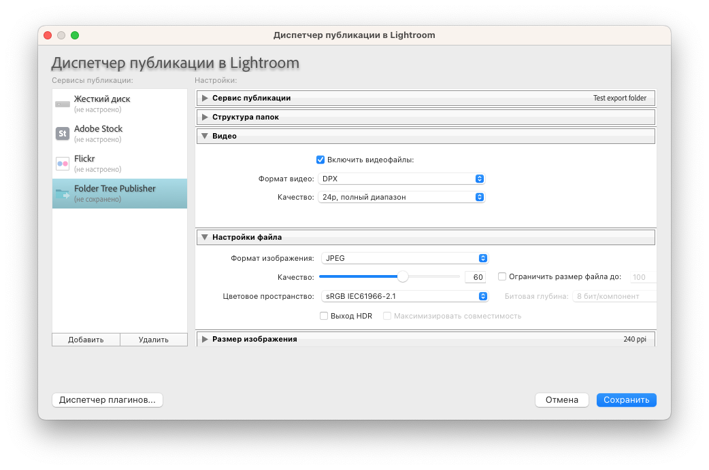
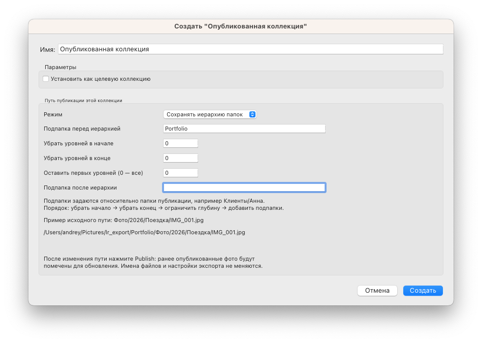
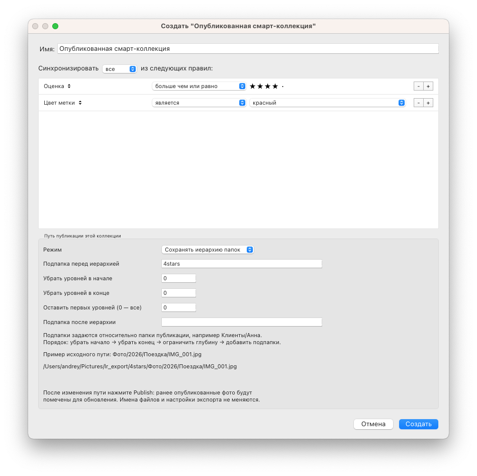
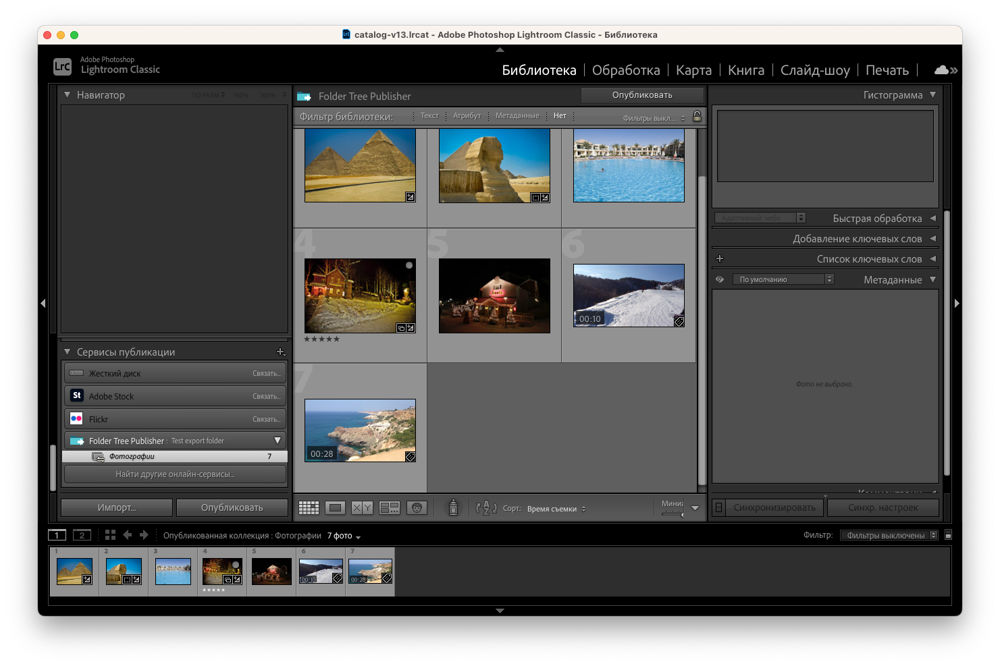
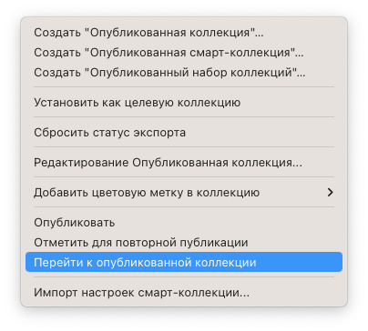
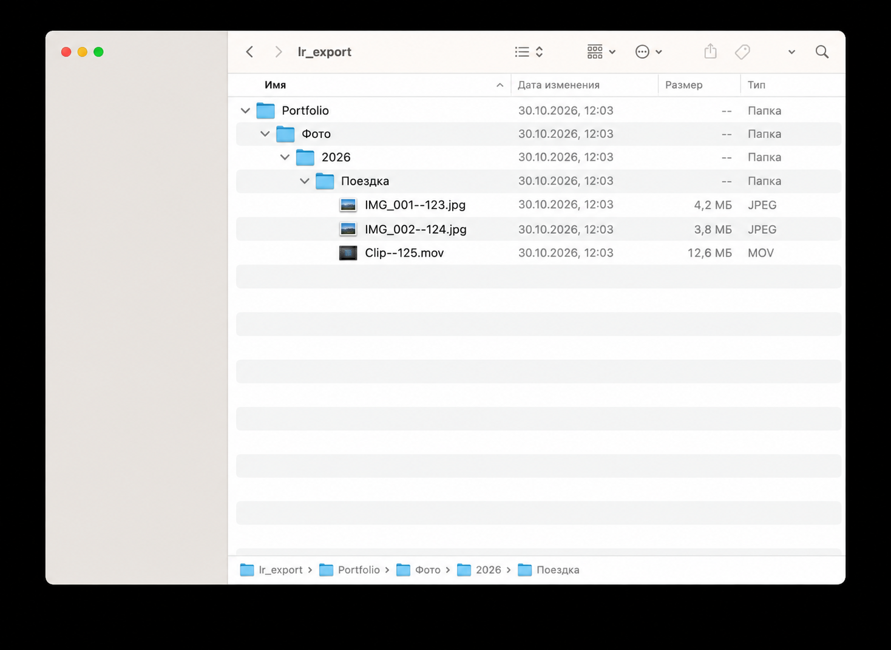

# Folder Tree Publisher: инструкция со скриншотами

[English](USER_GUIDE.md) · [Описание и ограничения](../README.ru.md)

Скриншоты сделаны в русскоязычном Lightroom Classic с плагином 0.8.0. Названия меню могут отличаться в зависимости от языка Lightroom. Пути на изображениях — примеры папок автора снимков; выберите собственную папку назначения.

## 1. Установка

Распакуйте архив плагина в постоянную папку. В Lightroom откройте **Файл → Диспетчер плагинов**, нажмите **Добавить** и выберите папку `FolderTreePublisher.lrplugin`.

Выберите **Folder Tree Publisher** в списке. Проверьте, что плагин включён и показан статус «Установлено и работает». В разделе «О плагине» доступны версия, контакты автора и лицензия. Нажмите **Готово**.



## 2. Настройка службы публикации

В модуле **Библиотека** найдите панель **Службы публикации** и настройте службу **Folder Tree Publisher**. Введите понятное описание службы.

При первоначальной настройке выберите отдельную существующую **папку публикации**. Иерархия исходных папок берётся из каталога Lightroom автоматически. После создания службы папка назначения недоступна для изменения — это видно на снимке. Для другого назначения создайте новую службу.

- **Добавлять ID фото к имени** помогает избежать совпадений имён и поддерживает виртуальные копии.
- **При удалении из публикации перемещать копии в корзину** управляет удалением опубликованных копий при очередной публикации. Если опция выключена, файлы на диске остаются. Оригиналы не удаляются.

Настройте также формат изображения, качество, размер и метаданные. Эти параметры общие для коллекций одной службы. Нажмите **Сохранить**.



## 3. Публикация видео

В настройках службы раскройте **Видео** и включите **Включить видеофайлы**. Без этой галочки Lightroom пропускает видео и может показать сообщение «Этот файл является видеофайлом».

Выберите формат видео и качество из вариантов, доступных в вашей версии Lightroom. На снимке выбран **DPX**; это пример настройки, а не обязательный формат. Для первой проверки можно выбрать **Оригинал / Original**, если этот пункт доступен. Настройки JPEG ниже относятся к фотографиям.

Сохраните настройки службы. Кодирование выполняет Lightroom, а плагин размещает результат по правилам пути коллекции.



## 4. Обычная опубликованная коллекция

В контекстном меню службы создайте **опубликованную коллекцию** и задайте имя. Снимки можно добавить в неё из библиотеки Lightroom.

В блоке **Путь публикации этой коллекции** настройте размещение файлов:

- **Режим** — сохранить иерархию папок или разместить файлы без неё.
- **Подпапка перед иерархией** — добавить, например, `Portfolio` перед исходными папками.
- **Убрать уровней в начале / в конце** — удалить указанное число уровней исходной иерархии.
- **Оставить первых уровней (0 — все)** — ограничить оставшуюся глубину.
- **Подпапка после иерархии** — добавить папку после исходных папок, перед именем файла.

Порядок обработки: убрать начало → убрать конец → ограничить глубину → добавить подпапки. Пути подпапок задаются относительно папки публикации; вложенные папки разделяются `/`.

На снимке добавлен префикс `Portfolio`, остальные параметры оставлены по умолчанию. Образец пути `Фото/2026/Поездка/IMG_001.jpg` становится `Portfolio/Фото/2026/Поездка/IMG_001.jpg` внутри папки назначения. Предпросмотр иллюстрирует правило на условном файле, а не на выбранном снимке.

Нажмите **Создать**. Если изменить путь уже существующей коллекции, её опубликованные файлы будут помечены для обновления. Нажмите **Опубликовать**, чтобы применить изменения на диске.



## 5. Опубликованная смарт-коллекция

Создайте **опубликованную смарт-коллекцию** в контекстном меню службы. Lightroom автоматически отбирает снимки по её условиям.

На снимке выбрано соответствие **всем** правилам: оценка **не ниже четырёх звёзд** и **красная цветовая метка**. В коллекцию попадут снимки, удовлетворяющие обоим условиям.

Настройки пути работают так же, как в обычной коллекции. В примере подпапка `4stars` добавляется перед иерархией. Имя коллекции само по себе не создаёт одноимённую папку на диске.

Нажмите **Создать**. Автоматический отбор снимков не запускает публикацию на диск: для этого нажмите **Опубликовать**.



## 6. Публикация коллекции

Откройте коллекцию службы, добавьте файлы в обычную коллекцию либо проверьте результат отбора в смарт-коллекции. На снимке выбрана коллекция «Фотографии» с семью элементами, включая два видео: их миниатюры показывают длительность.

Нажмите **Опубликовать** над сеткой или внизу левой панели. Дождитесь завершения обработки. Для применения последующих изменений используйте эту же кнопку. При необходимости выберите файлы и команду **Отметить для повторной публикации** в контекстном меню.



## 7. Открытие папки результата

Щёлкните правой кнопкой по опубликованной коллекции и выберите **Перейти к опубликованной коллекции**. В этом плагине команда открывает общую папку назначения службы в Finder на macOS или Проводнике на Windows. Вложенные папки коллекции можно раскрыть внутри неё.



## 8. Проверка структуры на диске

В Finder переключитесь в режим списка и раскройте вложенные папки. Сверьте размещение файлов с правилами пути коллекции.

На этом снимке показан отдельный пример с подпапкой **`1111` перед иерархией** и **`2222` после неё**. Например:

```text
lr_export/
└── 1111/
    └── 2009/
        └── 2009-09-08-Egypt/
            └── 2222/
                └── P1020733--5526.jpg
```

Числовые имена — пользовательские подпапки, а не обязательные имена плагина. В примере создания коллекции выше вместо `1111` задано `Portfolio`, а подпапка после иерархии отсутствует. Суффикс `--5526` в имени файла добавляется при включённой опции ID.



Видеопапки внизу снимка свёрнуты: их содержимое здесь не показано. Формат результата зависит от выбранных настроек видео. Для проверки отдельного видео откройте его папку и убедитесь, что результат читается подходящей программой.

## Если публикация не завершилась

- **«Этот файл является видеофайлом»**: проверьте галочку **Включить видеофайлы** в настройках службы.
- **Папка назначения недоступна**: подключите диск и убедитесь, что папка существует.
- **Файл существует, но не связан с публикацией**: выберите свободное назначение или проверьте конфликт; не удаляйте неизвестные файлы без проверки.
- При обращении к автору укажите версии плагина, Lightroom и ОС, точный текст ошибки и настройки коллекции.
